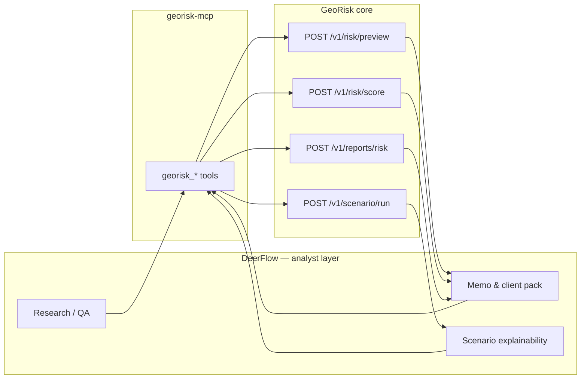

# DeerFlow × GeoRisk — VC-Builder ayrımı

**Status:** Canonical separation (v1)  
**Audience:** Ürün, mühendislik, DeerFlow skill yazarları

---

## Özet

| Katman | Rol | Bu repoda |
|--------|-----|-----------|
| **GeoRisk scoring core** | Deterministik, versiyonlu, audit edilebilir hesaplama motoru | `app/`, connector’lar, skor API’leri |
| **DeerFlow** | Workflow automation / analyst layer (SuperAgent harness) | `integrations/deerflow/` (MCP + skill only) |

**VC-builder mantığı:** DeerFlow skor **üretmez**; GeoRisk’ten alır, **yorumlar ve paketler**.

---

## DeerFlow (resmi konum)

[DeerFlow](https://bytedance-deer-flow.mintlify.app/) açık kaynak bir **SuperAgent harness**’tır:

- **Sandbox, memory, tools, skills, sub-agent** ile dakikalardan saatlere uzanan işleri çalıştırır.
- **Custom skills**, **MCP server**’lar ve **Python functions** ile genişletilir.

Bu projede DeerFlow şunlar için uygundur:

- Research ve kaynak sentezi  
- Rapor üretimi (memo, ek, brief)  
- Data QA ve tutarlılık kontrolleri  
- Müşteri çıktısı formatlama  
- Market map / competitive landscape metni  
- Yatırımcı memo’su ve committee özeti  
- **Scenario explainability** — Scenario-Lab JSON’unu insan diline çevirme (sayıları yeniden hesaplamadan)

DeerFlow **bu repoda vendored değildir**; ayrı kurulum + `georisk-vc-builder` skill kopyası.

### Süreç matrisi (nerede DeerFlow?)

| Süreç | DeerFlow uygun mu? | Not |
|-------|-------------------|-----|
| Climate literature / IPCC / CMIP6 araştırması | Evet | Kaynaklı research brief |
| Coğrafi veri QA | Evet | Grid, outlier, CRS, layer drift |
| Scenario coefficient **önerisi** | Evet, human approval ile | Agent önerir; tablo merge Core’da |
| Customer risk report üretimi | Evet | PDF/slide automation |
| Sales / investor memo / market map | Evet | VC-builder verimliliği |
| **Final risk / scenario score** | **Hayır** | Deterministik API (`scenario_scoring`) |
| Pricing / underwriting karar motoru | Hayır (doğrudan) | DeerFlow açıklama katmanı |

**Güven garantisi:** `aynı asset_id + model_version + scenario + horizon + coefficient_table_version` → aynı `scenario_scoring`. DeerFlow çevreyi hızlandırır; skor testlenebilir serviste kalır.

Senaryo matematiği: [scenario-scoring-v1.md](./scenario-scoring-v1.md) (hazard-only SSP uplift; final’e global 1.4× **yok**).

---

## GeoRisk scoring core

GeoRisk Engine tek kaynak doğruluk noktasıdır:

| Özellik | Uygulama |
|---------|----------|
| Deterministik (v1 stub’lar hariç aynı girdi → aynı çıktı) | Skor kalibrasyonu `app/scoring/`, connector fallback’leri |
| Versiyonlu | `RISK_SCORE_MODEL_VERSION`, rapor metadata |
| Audit edilebilir | `audit_id`, audit log, industrial verification `linked_audit_id` |
| API-first | `POST /v1/risk/score`, `/preview`, `/reports/*`, `/scenario/run` |

**Core yapmaz:** Serbest web araştırması, müşteriye özel slide düzeni, uzun süreli agent hafızası, sub-agent orkestrasyonu.

---

## Sınır kuralları (MUST / MUST NOT)

### DeerFlow MUST

- GeoRisk MCP araçlarını (`georisk_*`) skor ve rapor için çağırmak  
- `audit_id` / `audit_context` ile izlenebilirliği korumak  
- Disclaimer ve metodoloji tonunu yansıtmak (`docs/turkiye/snippets/`, API `disclaimer` alanları)  
- Scenario sonuçlarını **açıklamak**, düzenleyici çerçeveye **map etmek** (kanıt iddiası olmadan)

### DeerFlow MUST NOT

- `overall_score`, bileşen skorları veya scenario metriklerini **kendi başına icat etmek**  
- GeoRisk connector / kalibrasyon kodunu skill içine kopyalamak  
- Uydu proxy çıktısını **düzenleyici kanıt** olarak sunmak  
- Scenario-Lab stub çıktısını **aktüeryal zarar** veya bağlayıcı underwriting gibi göstermek

### GeoRisk Core MUST

- Tüm sayısal risk ve scenario stub çıktısını API üzerinden sunmak  
- Hata ve feragatleri yapılandırılmış JSON ile döndürmek  

### GeoRisk Core MUST NOT

- DeerFlow sandbox, memory veya sub-agent yaşam döngüsünü yönetmek  
- Uzun süreli analyst workflow state tutmak (v1; snapshot store process-içi ve geçicidir)

---

## Veri akışı (VC-builder)

---

## Repo eşlemesi

| DeerFlow yeteneği | GeoRisk / repo karşılığı |
|-------------------|---------------------------|
| 1-dk scorecard | UC-01 `POST /v1/risk/preview`, `computePreviewRiskScore` |
| CMIP6 scenario | UC-02 `POST /v1/scenario/run` |
| DD eki / PDF | `georisk_report_markdown`, `georisk_report_pdf` |
| VC memo şablonu | `integrations/deerflow/skill/.../assets/vc_memo_template.md` |
| Tam skor + audit | `georisk_score` → `audit_id` |

---

## English summary

**DeerFlow** is the open-source SuperAgent harness (sandbox, memory, tools, skills, sub-agents) used here as the **workflow / analyst layer** for research, reports, QA, customer deliverables, market maps, investor memos, and scenario *explanation*. **GeoRisk Engine** is the **deterministic, versioned, auditable scoring core** exposed via HTTP and MCP; it never replaces agent orchestration. VC-builder integration keeps all numbers on the Core side and all narrative on the DeerFlow side.

---

## Related

- [deerflow_vc_builder_georisk_engine.md](../integrations/deerflow_vc_builder_georisk_engine.md)  
- [integrations/deerflow/README.md](../../integrations/deerflow/README.md)  
- Use cases: [docs/use-cases/README.md](../use-cases/README.md)
