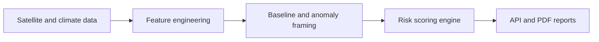

# GeoRisk Engine — Investor Pitch Deck

**Version:** v1.0  
**Date:** 2026-05  
**Status:** Draft / Internal

---

## 1. Title

**GeoRisk Engine**  
*Location-based risk intelligence for the physical world*

---

## 2. Problem

Institutional risk decisions still lack reliable **real-world** visibility.

- ESG assessments are often **static, manual, and lagging**
- Risk is modeled at **country or sector** level, not **asset** level
- **Climate and environmental** risks are **underpriced** and **opaque**
- **Data exists** but is **fragmented, technical, and hard to operationalize**

**Outcome:** mispriced risk · weak compliance signals · weaker capital allocation

---

## 3. Solution

**GeoRisk Engine** turns **satellite and climate data** into **decision-grade** risk signals.

- **Asset-level** ESG and operational-style risk scoring
- **Continuous monitoring** (not one-off reports)
- **Baseline comparison** and **change vs. climatology** framing
- **API-first** delivery (JSON + **PDF** reports)

**Positioning:** raw geospatial + climate data → **repeatable, explainable risk intelligence**

---

## 4. Product

### Core components

**Risk API** (FastAPI, versioned)

- `POST /v1/risk/score` — structured scores + feature bundles
- `GET /v1/gee/features` / `GET /v1/oras5/features` — diagnostic feature pulls
- `POST /v1/reports/risk` — markdown-style narrative
- `POST /v1/reports/risk/pdf` — **client-ready** PDF

**Data engine**

- **Google Earth Engine** — industrial / pollution proxies (e.g. night lights, NO₂) vs **default 30-year climatological baseline** (configurable)
- **ORAS5 (Zarr)** — **ocean / climate** context
- **Land** — *roadmapped* (e.g. ESA CCI class of products)

**Reporting**

- PDF + narrative tuned for **auditability** and **explainability**

---

## 5. How it works

---

## 6. Value proposition

| Capability | Value |
|------------|--------|
| Asset-level scoring | Precision vs. sector aggregates |
| Time-oriented analysis | Earlier detection of drift vs. baseline |
| Explainable outputs | Audit- and disclosure-friendly |
| API-first | Fast integration, automation, monitoring |

---

## 7. Target customers

- **Banks** — credit, ESG, and concentration risk
- **Insurance / reinsurance** — underwriting and exposure monitoring
- **Asset managers** — portfolio- and site-level surveillance
- **Corporates** — physical risk at facilities and supply nodes

---

## 8. Market opportunity

- Large and growing **ESG / sustainability data** spend
- **Climate risk analytics** expanding with **disclosure** and **stress-test** regimes
- **Regulatory tailwinds** (EU taxonomy, climate reporting, scenario expectations)

**Shift:** from **periodic reporting** → **continuous, location-aware monitoring**

---

## 9. Competitive landscape

| Category | Typical gap |
|----------|-------------|
| ESG data vendors | Aggregates; weak asset / site resolution |
| Climate analytics incumbents | Heavy, slow, or not operational for product teams |
| Raw satellite platforms | Imagery and indices — not **risk-as-a-service** |

**GeoRisk Engine:** the **intelligence layer** between **geospatial/climate data** and **risk and compliance workflows**.

---

## 10. Traction (early stage)

- **API-first MVP** in market
- **GEE + ORAS5** wired into scoring and diagnostics
- **Baseline / climatological comparison** model in product
- **PDF** reporting path live

---

## 11. Business model

- **Usage-based** API pricing
- **Enterprise** subscriptions (SLAs, volume, support)
- **Custom** analytics, regions, and report packs

---

## 12. Roadmap

**0–6 months**

- Deeper **land / agriculture** feature expansion
- **Audit / observability** hardening (e.g. analytics warehouse)
- Latency, cost, and reliability optimization

**6–12 months**

- **Portfolio** views and aggregations
- **Dashboard** and partner embed paths
- **ML** where it **adds** signal (not black-box replacement for explainable core)

---

## 13. Moat

- **Multi-source** ingestion (satellite + reanalysis / climate stores)
- **Feature + scoring** discipline tuned for **explanation**, not just accuracy theater
- **Infrastructure** positioning — default **integration surface** for physical risk
- Hard-to-replicate **workflow fit**: API + PDF + audit trail orientation

---

## 14. Vision

> **Become the default risk intelligence layer for the physical world** — so every material asset has a living, comparable, defensible risk profile.

---

## 15. Ask

- **Capital** to accelerate productization and GTM
- **Partnerships** with banks, insurers, and asset owners
- **Design partners** co-shaping portfolio and sector workflows

---

*End*
