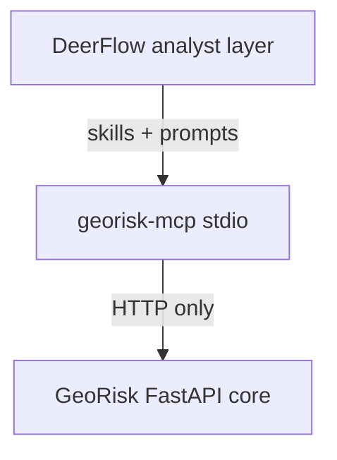

# DeerFlow VC Builder × GeoRisk Engine

**Status:** In-repo integration spec (v1)  
**Audience:** Engineers wiring DeerFlow agents to GeoRisk Engine

---

## Purpose

Connect [DeerFlow](https://bytedance-deer-flow.mintlify.app/) (super-agent harness with skills and MCP) to **GeoRisk Engine** so venture-capital and due-diligence workflows can pull **asset-level physical / ESG risk** into memos, appendices, and pitch materials—without duplicating scoring logic in the agent.

**VC** here means **venture capital** (investment memo / DD appendix), not vector/context builder.

---

## Separation of concerns (canonical)

| Layer | Role |
|-------|------|
| **GeoRisk scoring core** | Deterministic, versioned, auditable calculation (`audit_id`, model version, API contracts) |
| **DeerFlow** | Workflow automation / analyst layer — research, reports, data QA, client packs, market map, investor memo, scenario *explainability* |

DeerFlow is an open-source [**SuperAgent harness**](https://bytedance-deer-flow.mintlify.app/) (sandbox, memory, tools, skills, sub-agents; extensible via custom skills, MCP servers, Python functions). It **does not** live in this repo and **must not** reimplement scoring.

Full rules and diagrams: [docs/architecture/deerflow-georisk-separation.md](../architecture/deerflow-georisk-separation.md).

---

## Scope (v1)

| In scope | Out of scope (v1) |
|----------|-------------------|
| Single asset per tool call (lat/lon + name) | Portfolio aggregation API in GeoRisk |
| English memo default; TR disclaimer when user requests TR output | Full Turkish methodology rewrite |
| stdio MCP server + copyable DeerFlow skill | DeerFlow vendored inside this repo |
| Local / VPN GeoRisk (`GEORISK_BASE_URL`) | Production IdP, watermark enforcement |
| Optional `GEORISK_API_KEY` header on MCP client (for future API auth) | GeoRisk API key middleware (not implemented on server yet) |

---

## Architecture

1. **GeoRisk FastAPI** (`uvicorn app.main:app --port 8002`) — deterministic scores, reports, scenario stubs.
2. **MCP server** (`integrations/deerflow/mcp_server`) — thin HTTP adapter; no scoring logic.
3. **DeerFlow skill** (`integrations/deerflow/skill/georisk-vc-builder`) — memo templates, workflow, narrative; calls `georisk_*` only.

DeerFlow is installed separately; copy the skill into `deer-flow/skills/custom/georisk-vc-builder/` and enable MCP per `integrations/deerflow/README.md`.

---

## Outputs

| Output | Source |
|--------|--------|
| JSON score bundle | `POST /v1/risk/score` |
| Markdown DD appendix | `POST /v1/reports/risk` |
| PDF appendix | `POST /v1/reports/risk/pdf` |
| VC memo (agent-authored) | Skill template + MCP fields |

Default DD behavior: `include_industrial_verification_ref: true` on score and report unless the user opts out.

---

## Legal / tone

- Satellite and proxy indicators are **not** regulatory proof.
- For Turkish customer-facing text, include or reference `docs/turkiye/snippets/report_automatic_footer_disclaimer_tr.md`.
- NDA distribution patterns: `docs/turkiye/due-diligence/technical-overview-under-nda.md`.

---

## MCP tools

| Tool | HTTP |
|------|------|
| `georisk_health` | `GET /health` |
| `georisk_preview_scorecard` | `POST /v1/risk/preview` (UC-01) |
| `georisk_scenario_run` | `POST /v1/scenario/run` (UC-02) |
| `georisk_score` | `POST /v1/risk/score` |
| `georisk_report_markdown` | `POST /v1/reports/risk` |
| `georisk_report_pdf` | `POST /v1/reports/risk/pdf` (returns base64) |
| `georisk_list_demos` | `GET /v1/demo/assets` |

Environment: `GEORISK_BASE_URL`, `GEORISK_TIMEOUT_SECONDS`, optional `GEORISK_API_KEY`.

---

## Manual acceptance

1. Start GeoRisk: `uvicorn app.main:app --port 8002`
2. Install MCP: `pip install -e integrations/deerflow/mcp_server`
3. Run `georisk-mcp` (stdio) or enable in DeerFlow `extensions_config.json`
4. In DeerFlow, prompt: *Build a VC physical-risk appendix for the coastal industrial demo asset.*

---

## Related repo paths

- Separation of concerns: `docs/architecture/deerflow-georisk-separation.md`
- Integration README: `integrations/deerflow/README.md`
- Investor narrative structure: `docs/business/investor-pitch.md`
- Risk schemas: `app/schemas/risk.py`
