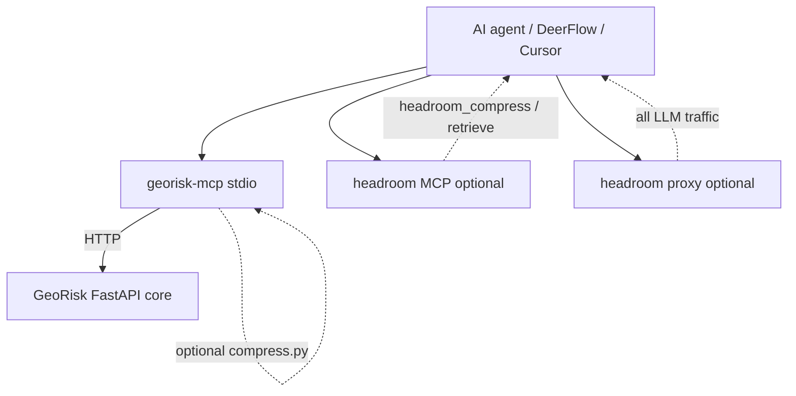

# Headroom × GeoRisk Engine

**Status:** In-repo integration spec (v1)  
**Audience:** Engineers wiring AI agents (Cursor, DeerFlow, Claude Code) to GeoRisk MCP with token-efficient context

---

## Purpose

Connect [Headroom](https://github.com/chopratejas/headroom) — a local-first context compression layer — to **GeoRisk Engine** MCP tools so agent workflows (VC memos, scenario explainability, DD appendices) consume **fewer tokens** without changing GeoRisk's deterministic scoring core.

Headroom compresses what the **agent reads** (tool outputs, logs, reports). GeoRisk continues to produce authoritative JSON/Markdown/PDF on the server.

---

## Separation of concerns

| Layer | Role |
|-------|------|
| **GeoRisk scoring core** | Deterministic, versioned, auditable calculation (`audit_id`, model version, API contracts) |
| **georisk-mcp** | Thin HTTP adapter; no scoring logic |
| **Headroom** | Optional compression of MCP tool payloads or full LLM traffic via proxy |

Headroom **must not** re-score assets or alter numeric fields before they are returned from GeoRisk HTTP APIs. Compression applies **after** the MCP server receives the HTTP response.

Full DeerFlow boundary rules: [deerflow-georisk-separation.md](../architecture/deerflow-georisk-separation.md).

---

## When compression helps

| GeoRisk MCP tool | Large payload source |
|------------------|----------------------|
| `georisk_score` | Component breakdown, GEE feature dict, industrial verification ref |
| `georisk_scenario_run` | Hazard matrices, propagation paths, scenario_scoring block |
| `georisk_report_markdown` | Full methodology sections and disclaimers |
| `georisk_report_pdf` | Base64 PDF wrapper JSON |
| `georisk_preview_scorecard` | Preview components + disclaimer text |

Smaller tools (`georisk_health`, `georisk_list_demos`) usually stay below the default `GEORISK_MCP_COMPRESS_MIN_TOKENS` threshold (800).

---

## Architecture

1. **GeoRisk FastAPI** — source of truth for scores and reports.
2. **georisk-mcp** — calls GeoRisk HTTP endpoints; optionally wraps responses through Headroom when `GEORISK_MCP_COMPRESS=1`.
3. **Headroom** — separate install; MCP tools (`headroom_compress`, `headroom_retrieve`, `headroom_stats`) and/or HTTP proxy.

---

## Integration modes (v1)

### Mode A — Dual MCP servers (recommended)

Install both MCP servers. Agent workflow:

1. Call `georisk_score` / `georisk_report_markdown` / etc.
2. Optionally call `headroom_compress` on large results before reasoning.
3. Call `headroom_retrieve` if full original content is needed (CCR, ~1h TTL).

Config snippet: `integrations/headroom/examples/mcp_config.snippet.json`.

### Mode B — Automatic georisk-mcp compression

Set `GEORISK_MCP_COMPRESS=1` and install `headroom-ai[mcp]` in the same venv as `georisk-mcp`. Implementation: `integrations/deerflow/mcp_server/georisk_mcp/compress.py`.

Compressed responses use a stable envelope with `_georisk_mcp` metadata and a string `payload` field. Agents should read `payload` for the compressed content.

### Mode C — Headroom proxy only

No GeoRisk code changes. Run `headroom proxy` and point the agent's LLM base URL at the proxy. GeoRisk MCP tools remain unchanged; conversation-level compression handles history and reasoning context.

---

## Environment

| Variable | Used by | Default |
|----------|---------|---------|
| `GEORISK_BASE_URL` | georisk-mcp | `http://127.0.0.1:8002` |
| `GEORISK_MCP_COMPRESS` | georisk-mcp | off |
| `GEORISK_MCP_COMPRESS_MIN_TOKENS` | georisk-mcp | `800` |
| `GEORISK_MCP_COMPRESS_TARGET_RATIO` | georisk-mcp | `0.5` |
| `GEORISK_MCP_COMPRESS_MODEL` | georisk-mcp | `claude-sonnet-4-5-20250929` |
| `HEADROOM_OUTPUT_SHAPER` | headroom proxy | off |

---

## Legal / audit notes

- Compression does **not** replace GeoRisk disclaimers. Agents must still surface `disclaimer` fields and Turkish footer snippets when producing customer-facing text.
- For audit trails, persist **`audit_id`** from uncompressed GeoRisk responses (available inside compressed JSON payloads).
- CCR retrieval is best-effort and TTL-bound; do not rely on Headroom as long-term evidence storage.

---

## Manual acceptance

1. Start GeoRisk: `uvicorn app.main:app --port 8002`
2. Install: `pip install -e integrations/deerflow/mcp_server "headroom-ai[mcp]"`
3. Mode B: `GEORISK_MCP_COMPRESS=1 georisk-mcp` — call `georisk_score`, verify `_georisk_mcp.compressed` when payload is large.
4. Mode A: `headroom mcp install` + merge MCP config — verify `headroom_compress` appears in agent tool list.
5. Run tests: `PYTHONPATH=. pytest integrations/headroom/tests integrations/deerflow/tests -q`

---

## References

- Headroom repo: https://github.com/chopratejas/headroom
- Headroom MCP docs: https://headroom-docs.vercel.app/docs/mcp
- GeoRisk DeerFlow integration: [deerflow_vc_builder_georisk_engine.md](./deerflow_vc_builder_georisk_engine.md)
